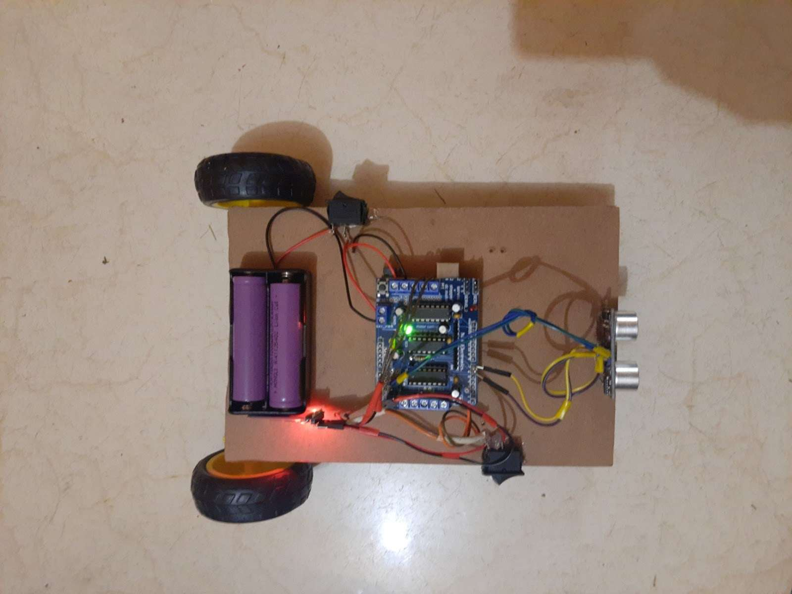
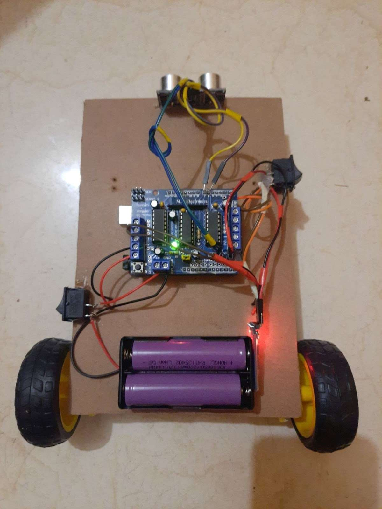
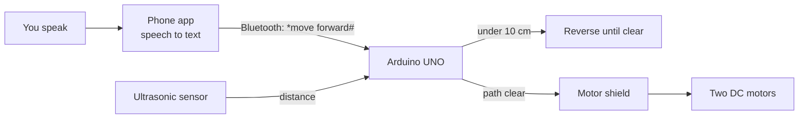
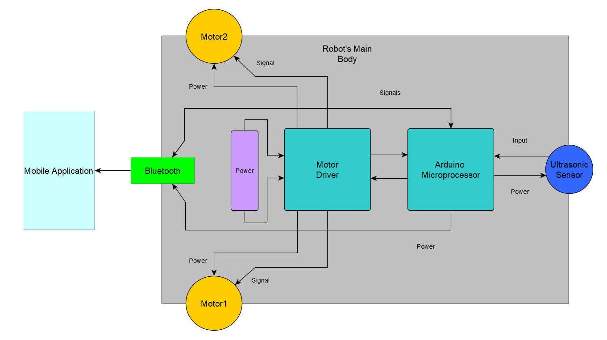

  
  
  

**Walter** is a small robot car you drive by talking to it. Say "move forward" into your phone, the phrase travels over Bluetooth to an Arduino, and Walter moves. An ultrasonic sensor on the front keeps it from running into things.

<table>
  <tr>
    <td width="64%"></td>
    <td width="36%"></td>
  </tr>
</table>

## How it works

1. The AMR_Voice Android app turns speech into text and sends it over Bluetooth serial, wrapped as `*phrase#`.
2. The Arduino reads the phrase and matches it against the commands it knows.
3. Before it acts, it pings the ultrasonic sensor. If something is closer than 10 cm it stops and backs away in half-second bursts until the path is clear.
4. Otherwise it drives the two motors through the motor shield for a fixed burst and stops, ready for the next command.

## Voice commands

| Say | Walter does |
| :--- | :--- |
| "move forward", "forward" | Drives forward for 0.8 s |
| "move backward", "backward", "move back", "back" | Reverses for 0.8 s |
| "turn left", "move left", "left" | Spins left for 0.4 s |
| "turn right", "move right", "right" | Spins right for 0.4 s |
| "stop", "halt", "pause" | Releases both motors |

## Parts

| Part | Notes |
| :--- | :--- |
| Arduino UNO | The brain |
| Motor driver shield | Adafruit Motor Shield v1 compatible, driven with the `AFMotor` library. Motors on M1 and M2. |
| 2 DC gear motors and wheels | Differential drive |
| HC-SR04 ultrasonic sensor | Trigger on pin 6, echo on pin 7 |
| HC-05 Bluetooth module | Serial at 9600 baud |
| Battery pack | Powers the shield and the board |

## Build it

1. Stack the motor shield on the UNO. Wire the motors to M1 and M2, the HC-SR04 to pins 6 and 7, and the HC-05 to the serial pins.
2. Install the **Adafruit Motor Shield library** (`AFMotor`) from the Arduino Library Manager.
3. Open [`Walter/Walter.ino`](Walter/Walter.ino) and upload it. Unplug the Bluetooth module while uploading, because it shares the serial pins.
4. Pair your phone with the HC-05, open AMR_Voice, connect, and start talking.

Open the Serial Monitor at 9600 baud to watch distance readings and incoming commands.

## More

The full write-up, with component specs, flow charts and serial output, is in [`Project_report.pdf`](Project_report.pdf).

Built by Alabhya Sharma and Pulak Jain at VIT Chennai.
